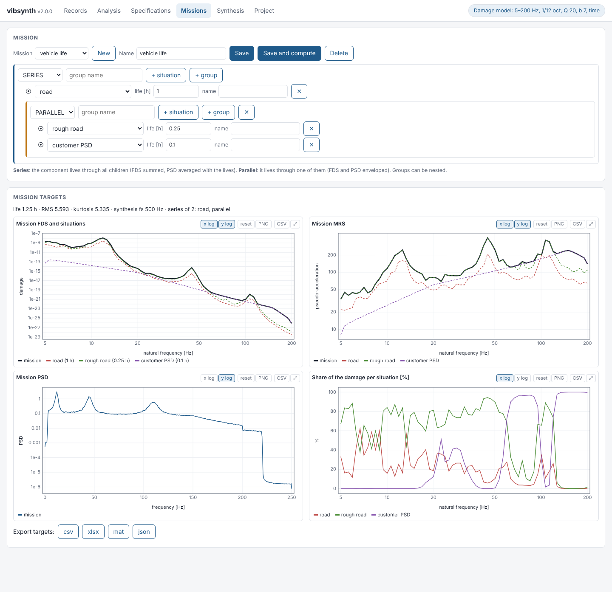
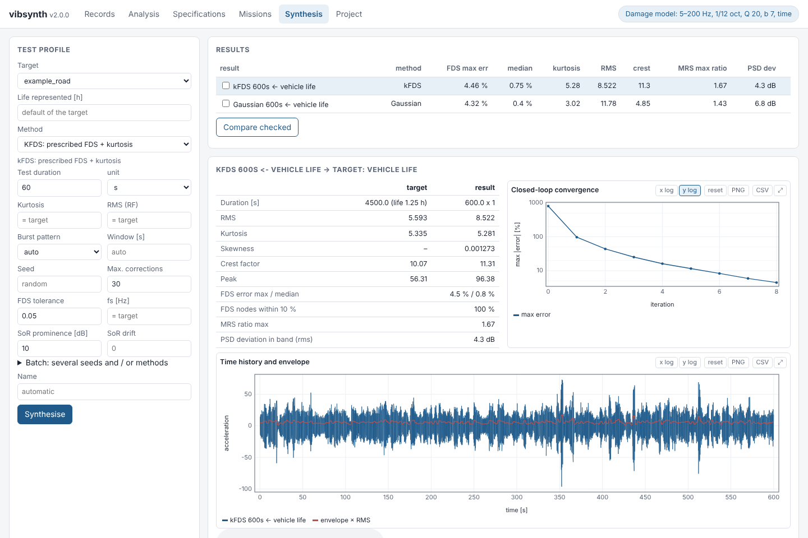

# vibsynth

**Accelerated vibration test synthesis in Python.** vibsynth turns measured
vibration (or a specification, or a whole multi-situation mission) into a
shorter shaker test profile that produces the same fatigue damage, while also
controlling the kurtosis, the RMS or the PSD of the test. It also contains
kurtosis control methods for non-Gaussian random vibration tests.

The algorithms are those of my PhD dissertation *Advanced Mission Synthesis
Algorithms for Vibration-based Accelerated Life-testing* (University of
Bologna, 2021), implemented here as a tested Python package with a browser
interface, a command line and a Python API.



| Family | Method | Prescribes |
|---|---|---|
| FDS controlled | `gaussian` | FDS (standard Mission Synthesis, Lalanne) |
| | `kfds` | FDS + kurtosis |
| | `rf` | FDS + RMS |
| | `pf` | FDS + PSD + RMS |
| | `psf` | FDS + PSD shape |
| | `sor` | FDS with deterministic tones (sine on random) |
| Shock severity | `mrs` | Maximum Response Spectrum (MRS control) |
| Kurtosis control | `mlv` | PSD + kurtosis (multi-level variance) |
| | `vsd` | PSD + kurtosis (variable spectral density) |
| | `pm` | PSD + kurtosis (phase manipulation) |

## Install

Python 3.9 or newer with numpy, scipy and matplotlib; optional openpyxl (Excel
export) and h5py (MATLAB v7.3 files). Everything runs locally and offline: the
interface is served on 127.0.0.1 and its charts are drawn by the package itself.

```
git clone https://github.com/epesaresi/vibsynth.git
cd vibsynth
pip install .            # or: pip install numpy scipy matplotlib openpyxl
```

On Windows you can also download the ZIP from GitHub, unpack it and
double-click `START_GUI.bat` (it installs the dependencies if they are missing).

## Quick start

```
python -m vibsynth gui
```

opens the interface at `http://127.0.0.1:8765`. The repository contains a
synthetic example record, `examples/example_road.mat` (300 s at 500 Hz, a road
transport like signal with kurtosis about 6, generated by
`examples/make_example.py`), so everything below works out of the box:

```
python -m vibsynth analyze examples/example_road.mat --fmin 5 --fmax 200 --Q 20 --b 7
python -m vibsynth synth   examples/example_road.mat --fmin 5 --fmax 200 --Q 20 --b 7 \
       --method kfds --duration 30 --out test.mat --report test.png
```

Python (everything the interface does is a `Workspace` call):

```python
import vibsynth as vs
ws = vs.Workspace(); ws.settings.update(fmin=5, fmax=200, Q=20, b=7)
x, fs = vs.load_signal("examples/example_road.mat")
rec = ws.add_record(x, fs, "example")
road, rough = ws.split(rec, [150])
spec = ws.add_spec(vs.PSDSpec([5, 20, 150, 200], [0.05, 0.3, 0.3, 0.05], "customer spec"))
m = ws.set_mission({"name": "life", "root": {"type": "group", "kind": "series", "children": [
      {"type": "situation", "item": road, "life_h": 1.0},
      {"type": "group", "kind": "parallel", "children": [
          {"type": "situation", "item": rough, "life_h": 0.25},
          {"type": "situation", "item": spec, "life_h": 0.1}]}]}})
res = ws.synthesize(m, "kfds", 600, seed=1)
print(ws.get(res).meta["eval"]["fds_max_error_pct"])     # about 4.5 %
open("life.vsproj", "wb").write(ws.save_project())
```



Tests: `pytest tests` (22 tests; they also run automatically on GitHub for
Linux and Windows). The interface was also tested end to end in a browser.

## Features

* **Import**: .mat (v5, v7, v7.3), CSV, TXT, NPY; several files at once; choice
  of MAT variable and columns; m/s² or g.
* **Pre-processing**: crop, high/low/band-pass, mean removal, resampling, gain,
  split into situations (the zoom range of a chart can be used as input);
  history kept.
* **Interactive charts**: box zoom, wheel zoom per axis, pan, lin/log axes,
  hover read-out, legend toggling, enlarge, PNG and CSV of the visible data;
  long records reloaded at full resolution when zoomed.
* **FDS and MRS**: exact time domain (rainflow, multithreaded), fast
  approximate (self-calibrated) or frequency domain (Lalanne); any 1/n octave
  or linear grid; overlay of any number of records, specifications and
  missions.
* **Specifications**: PSD breakpoints and swept sine, with preview, RMS and
  duration; usable as target, as mission situation, or turned into a time
  history.
* **Multi-situation missions**: tree editor with nested series and parallel
  groups of records and specifications and a life per situation; mission FDS,
  MRS, PSD, kurtosis and RMS; damage share of each situation.
* **Synthesis**: 10 methods with closed-loop FDS correction; batch over seeds
  and methods; comparison table and overlay of the FDS errors.
* **Result checks**: FDS error, MRS ratio (yield check), PSD deviation, 1 s RMS
  distribution, envelope, convergence; sensitivity to b and Q; PDF matching;
  shaker stroke, velocity and acceleration check with a suggested high-pass.
* **Diagnostics**: statistics, PDF, spectrogram, running RMS and kurtosis,
  spectral kurtosis, kurtogram, SDOF response at any natural frequency, audio
  playback.
* **Export**: FDS, MRS, PSD and statistics of any record, specification,
  mission or result as CSV, XLSX, MAT, JSON; time histories as MAT ([t x]
  matrix), CSV, TXT, NPY, WAV.
* **Projects**: a .vsproj file keeps records, specifications, missions,
  results, damage model and log.

## How it works

1. **One formulation for kFDS, RF and MLV: a Gaussian carrier times an envelope,
   x(t) = e(t) g(t).** For a Gaussian carrier the kurtosis is exactly
   3<e^4>/<e^2>^2, the RMS is rms(g) sqrt(<e^2>), and the damage is D_g <e^b>.
   With <e^b> = 1 the FDS is preserved for *any* envelope: this is the
   continuous form of the block weights v_j of the dissertation
   (e_j = (n v_j)^(1/b)). One scalar, the envelope contrast, is then solved
   with a root finder on the realised signal, so the kurtosis or RMS target is
   met exactly.
2. **No waveform jumps.** A single continuous carrier is modulated, so there are
   no discontinuities between independently generated blocks. Level changes are
   linear ramps.
3. **A natural burst structure.** By default the envelope levels are drawn from
   the measured distribution of the reference's window RMS, so the synthetic
   signal has bursts with the same statistics as the field data. Random bursts
   (10 to 20 % of the windows) are also available (`pattern="bursts"`).
4. **Windows long enough for the oscillators.** A level change must last at
   least 2 decay times of the slowest oscillator (tau = Q / (pi fn_min)); PF and
   PSF use at least two bursts of 3 decay times when the test is long enough.
   Otherwise a block does not produce its stationary (Lalanne) damage, which is
   what the design assumes.
5. **An exact FDS-to-PSD inversion.** The response variance is linear in the PSD
   (s = W G, W = Lalanne's matrix). The inversion is a positive linear problem,
   solved to 1e-4. The anti-aliasing pre-filter of the time-domain FDS is
   included in W, so the design is consistent with the measurement.
6. **An automatic closed loop.** The rainflow FDS of the realised signal is
   measured, and the carrier spectrum is reshaped by (D_target/D)^(w/b), with
   zero phase and the envelope untouched. The relaxation w adapts and bad steps
   are undone. This removes the known bias between Lalanne's Gaussian formula
   and rainflow counting, which reaches 90 % at high natural frequencies when
   there are only 2.5 to 4 samples per period (fs = 2.5 fmax).
7. **PF/PSF as two mixed carriers**, x = sqrt(m) x_B + sqrt(1-m) x_L, with a
   smooth switching mask. The overall PSD is exactly (t_B G_B + t_L G_L)/T.
   G_B is solved so that the burst damage plus the low-energy damage equals the
   target. When PSD, RMS and FDS are not all reachable, the code says so instead
   of silently over-testing.
8. **Fast rainflow without compiled code.** Vectorised 4-point passes, plus a
   linear stack finish for long free decays. The damage sums equal those of a
   plain sequential ASTM E1049 implementation to 1e-10 (see the tests).

## Results

**Synthetic example record** (`examples/example_road.mat`: RMS 6.05 m/s², kurtosis
6.04), FDS 5 to 200 Hz at 1/12 octave (65 oscillators), Q = 20, b = 7. The FDS
error is the exact rainflow FDS of the synthesised profile against the target,
over all 65 oscillators (`python tools/benchmark.py`, full table in
`docs/benchmark_example.json`):

| Case | Gaussian | kFDS | RF | PF | PSF |
|---|---|---|---|---|---|
| no acceleration (300 s) | 4.6 % | 4.9 % | 4.9 % | 4.2 % | 4.2 % |
| acceleration x5 (3000 s of life in 600 s) | 4.5 % | 4.5 % | 4.2 % | 4.2 % | 4.1 % |
| acceleration x10 (300 s of life in 30 s) | 4.3 % | 4.8 % | 7.8 % | 4.5 % * | 4.8 % |

kFDS keeps the kurtosis of the record (5.96 to 6.0), RF the RMS (6.07) and PF
the PSD (0.3 dB). \* PF at x10 warns that its bursts are shorter than three
decay times of the 5 Hz oscillator.

**Thesis reference record** (287 s at 500 Hz, kurtosis 6.47, the profile of
Fig. 3.11 of the dissertation; the record itself is not distributed), same
settings, full table in `docs/benchmark_thesis_record.json`:

* Without acceleration and at acceleration x5, all five FDS methods reach a
  maximum FDS error below 5 %, with a median around 0.1 to 1 %. kFDS
  reproduces the kurtosis to 0.1 and RF the RMS to 1 %. PF also keeps the
  PSD within 0.6 to 1.1 dB.
* At acceleration x9.6 (287 s of life in 30 s), Gaussian and kFDS still meet
  the FDS (4 %). RF reaches 13 %, but only with kurtosis 39 (extreme bursts).
  PF and PSF are not feasible: the bursts would have to be shorter than the
  decay time of the 5 Hz oscillator, and the code says so. This is
  consistent with the conclusion of the thesis that kFDS is the most robust
  algorithm for accelerated tests.
* Kurtosis control (MLV, VSD, PM) reaches the target kurtosis exactly with a
  PSD deviation of 0.2 to 0.3 dB. Over the same duration, however, its FDS
  differs from the reference by up to a factor of 3 or 4 (the point of chapter
  3: kurtosis control alone does not control the damage).

## Limits

* The building blocks (rainflow, Lalanne matrix, PSD synthesis, frequency grid)
  are checked in the tests against reference implementations and closed-form
  results. Synthesised signals are random, so two runs with different seeds
  differ sample by sample while meeting the same targets.
* MATLAB v7.3 (.mat HDF5) files need `pip install h5py`.
* Mission rules: in a parallel group the life, RMS and kurtosis are those of
  the most damaging child. Specifications enter missions through Lalanne's
  Gaussian FDS (PSD) or the exact FDS of the generated sweep (swept sine).
* Sine on random detects the tones in the reference PSD or takes a list of
  them; harmonic tracking from a measured rpm is not included.
* The server is single-user and local (127.0.0.1); one computation runs at a
  time and can be cancelled.
* As with any test tailoring tool, the result is only as good as the damage
  model (Q, b) and the measured data; check the yield (MRS ratio) and the
  shaker limits before running a test.

## Citing

If vibsynth is useful in your work, please cite the dissertation (the
`CITATION.cff` file gives GitHub's "Cite this repository" button):

> E. Pesaresi, *Advanced Mission Synthesis Algorithms for Vibration-based
> Accelerated Life-testing*, PhD dissertation, Alma Mater Studiorum, University
> of Bologna, 2021. https://amsdottorato.unibo.it/id/eprint/9647/

## Acknowledgements

The methods were developed during my PhD at the University of Bologna. I
thank Prof. Marco Troncossi and Easting s.r.l.s. for our joint work in those
years.

I also thank Claude (Anthropic), the AI assistant that translated my original
MATLAB code into this Python package and helped extend it with the browser
interface, the missions and the tests. All algorithms and results were checked
by me against the dissertation.

## License

MIT, see `LICENSE`. Contributions and bug reports are welcome through GitHub
issues.
