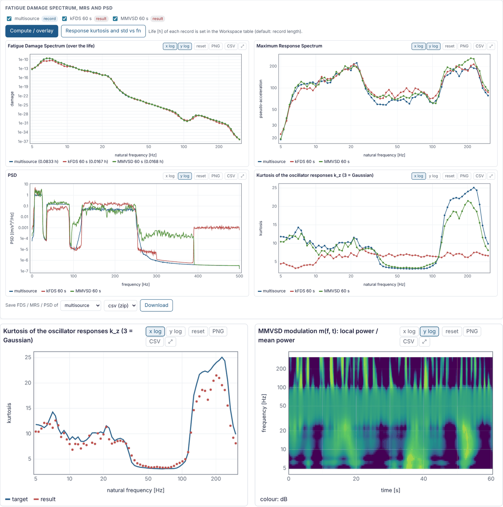

# vibsynth

[](https://doi.org/10.5281/zenodo.23298865)
[](https://github.com/epesaresi/vibsynth/actions/workflows/tests.yml)
[](LICENSE)

**Accelerated vibration test synthesis in Python.** vibsynth turns measured
vibration (or a specification, or a whole multi-situation mission) into a
shorter shaker test profile that produces the same fatigue damage, while also
controlling the kurtosis, the RMS or the PSD of the test. Version 2.1 adds
**MMVSD**, which also reproduces the kurtosis of the response at every natural
frequency, and the detection of **sine-on-random blocks** in records.

The methods of version 2.0 are those of my PhD dissertation *Advanced Mission
Synthesis Algorithms for Vibration-based Accelerated Life-testing* (University
of Bologna, 2021); MMVSD extends its variable-spectral-density idea. Everything
is a tested Python package with a browser interface, a command line and a
Python API. This page assumes you know what a PSD, a shaker test and an S-N
curve are; every concept beyond that is derived step by step in the
[theory manual](docs/theory/vibsynth_theory.pdf) (40 pages, from the
definition of a PSD to the Jacobians of MMVSD).


## What is new in 2.1

* **MMVSD** (`mmvsd`): prescribes the Fatigue Damage Spectrum *and* the kurtosis
  of the oscillator responses, k<sub>z</sub>(f<sub>n</sub>), with a PSD whose shape
  changes in time. The bursts follow either the statistics of the record or its
  own time-frequency pattern.
* **Sine-on-random blocks**: engine orders and other tonal lines that appear only
  in some parts of a record are detected, extracted and reproduced as
  deterministic sines; the random part is designed for the rest.
* **Response kurtosis k<sub>z</sub> everywhere**: for records, specifications,
  missions and every result, in the interface, the command line report and the
  benchmark.
* **Faster exact FDS**: one pass gives FDS, MRS and the response statistics; long
  records use all CPU cores, with identical results.
* The methods of version 2.0 give exactly the same profiles as before.

## Which method should I use?

| You want a test that | Method |
|---|---|
| has the damage of the field; Gaussian is fine | `gaussian` |
| has the damage and the kurtosis of the field | `kfds` |
| has the damage and the RMS of the field | `rf` |
| has the damage and the PSD (or its shape) of the field | `pf`, `psf` |
| has the damage with stationary tonal lines | `sor` |
| has the damage and the right kurtosis **in every band** (road, engine and impacts behave differently), keeps sine-on-random blocks, or keeps the bursts where they were | `mmvsd` |
| reproduces the peak severity (Maximum Response Spectrum) | `mrs` |
| has the PSD and kurtosis of the field, without damage equivalence | `mlv`, `vsd`, `pm` |

## Install

Python 3.9 or newer with numpy, scipy and matplotlib; optional openpyxl (Excel
export) and h5py (MATLAB v7.3 files). Everything runs locally and offline: the
interface is served on 127.0.0.1 and its charts are drawn by the package itself.

```
git clone https://github.com/epesaresi/vibsynth.git
cd vibsynth
pip install .            # or: pip install numpy scipy matplotlib openpyxl
```

On Windows you can also download the ZIP from GitHub, unpack it and
double-click `START_GUI.bat` (it installs the dependencies if they are missing).

## Quick start

```
python -m vibsynth gui
```

opens the interface at `http://127.0.0.1:8765`. The repository contains a
synthetic example record, `examples/example_road.mat` (300 s at 500 Hz, a
road-transport-like signal with kurtosis about 6, generated by
`examples/make_example.py`), so everything below works out of the box. The
first command prints the statistics and the FDS, the other two write a 30 s
kFDS test and a 60 s MMVSD test as `.mat` files with a report figure:

```
python -m vibsynth analyze examples/example_road.mat --fmin 5 --fmax 200 --Q 20 --b 7
python -m vibsynth synth   examples/example_road.mat --fmin 5 --fmax 200 --Q 20 --b 7 \
       --method kfds --duration 30 --out test.mat --report test.png
python -m vibsynth synth   examples/example_road.mat --fmin 5 --fmax 200 --Q 20 --b 7 \
       --method mmvsd --duration 60 --modulation pattern --out test.mat --report test.png
```

Two more synthetic records are generated on demand:
`python examples/make_multisource.py` (road, engine and impact sources with
different non-Gaussianity per band) and `python examples/make_sor.py` (engine
lines in some blocks only).

Python (everything the interface does is a `Workspace` call):

```python
import vibsynth as vs
ws = vs.Workspace(); ws.settings.update(fmin=5, fmax=200, Q=20, b=7)
x, fs = vs.load_signal("examples/example_road.mat")
rec = ws.add_record(x, fs, "example")
road, rough = ws.split(rec, [150])
spec = ws.add_spec(vs.PSDSpec([5, 20, 150, 200], [0.05, 0.3, 0.3, 0.05], "customer spec"))
m = ws.set_mission({"name": "life", "root": {"type": "group", "kind": "series", "children": [
      {"type": "situation", "item": road, "life_h": 1.0},
      {"type": "group", "kind": "parallel", "children": [
          {"type": "situation", "item": rough, "life_h": 0.25},
          {"type": "situation", "item": spec, "life_h": 0.1}]}]}})
res = ws.synthesize(m, "kfds", 600, seed=1)
print(ws.get(res).meta["eval"]["fds_max_error_pct"])     # about 4.5 %
mm = ws.synthesize(rec, "mmvsd", 60, seed=1, modulation="pattern")
print(ws.get(mm).meta["eval"]["kz_median_abs_err"])      # kurtosis of the responses
open("life.vsproj", "wb").write(ws.save_project())
```


Tests: `pytest tests` (45 tests; they also run automatically on GitHub for
Linux and Windows). The interface was also tested end to end in a browser.
`python -m vibsynth --help` lists the command line options; the method and
damage-model settings are explained in the theory manual, Section 10.

## The ideas in one page

* **Fatigue Damage Spectrum (FDS).** The damage that a vibration causes in a
  family of single-degree-of-freedom oscillators (natural frequency f<sub>n</sub>,
  quality factor Q), with rainflow counting and a Basquin law of exponent b. Two
  signals with the same FDS damage every lightly damped component alike, so the
  FDS is what every synthesis method reproduces.
* **Kurtosis of the responses, k<sub>z</sub>(f<sub>n</sub>).** The damage depends on
  how many *large* cycles the response has, and the oscillator filters the input:
  bursts shorter than its response time Q/(2&pi;f<sub>n</sub>) do not reach it. The
  kurtosis of the input is one number; the kurtosis of the responses is a curve
  over f<sub>n</sub>, and it is this curve that governs the damage mechanism.
* **Envelope times carrier (kFDS, RF, MLV).** x(t) = e(t) g(t) with a Gaussian
  carrier g: the kurtosis is exactly 3&lang;e<sup>4</sup>&rang;/&lang;e<sup>2</sup>&rang;<sup>2</sup>,
  and &lang;e<sup>b</sup>&rang; = 1 keeps the FDS for any envelope. One envelope
  gives the same k<sub>z</sub> at all frequencies.
* **MMVSD.** The local PSD changes in time, G(f, t) = P(f) m(f, t) with
  &lang;m&rang; = 1, so the PSD of the test is exactly P. A model of the
  oscillator responses (local spectral moments, the response time, Dirlik's
  damage, the exact response of the sampled oscillator) gives the FDS and
  k<sub>z</sub> of every design; P and the depth of the modulation are solved with
  exact Jacobians, and a closed loop on the realised signal (exact rainflow
  FDS and measured k<sub>z</sub>) corrects what the model neglects.
* **Sine-on-random blocks.** A tonal line is phase coherent over a block, a narrow
  random resonance is not; this test separates them. The lines are extracted,
  replayed as sines amplified to keep their share of the life damage, and the
  random part is designed for the residual.
* **Closed loop.** Every FDS method measures the rainflow FDS of the realised
  profile and corrects its spectrum (frozen phases) until it meets the target.

The [theory manual](docs/theory/vibsynth_theory.pdf) derives all of this step by
step, from the definition of a PSD to the Jacobians of MMVSD.

## Results

**Synthetic example record** (`examples/example_road.mat`: RMS 6.05 m/s², kurtosis
6.04), FDS 5 to 200 Hz at 1/12 octave (65 oscillators), Q = 20, b = 7, seed 1
(`python tools/benchmark.py`, full table in `docs/benchmark_example.json`).
The FDS error is the exact rainflow FDS of the synthesised profile against the
target, maximum over the 65 oscillators; k<sub>z</sub> is the median over the
oscillators of the absolute error of the response kurtosis (the record's
k<sub>z</sub> runs from about 4 to 12):

| Case | Gaussian | kFDS | RF | PF | PSF | MMVSD |
|---|---|---|---|---|---|---|
| no acceleration (300 s): max FDS error | 4.6 % | 4.9 % | 4.9 % | 4.2 % | 4.2 % | 2.0 % |
| &nbsp; k<sub>z</sub> error | 2.56 | 0.64 | 0.69 | 0.48 | 0.48 | 0.23 |
| acceleration x5 (3000 s of life in 600 s): max FDS error | 4.5 % | 4.5 % | 4.2 % | 4.2 % | 4.1 % | 4.2 % |
| &nbsp; k<sub>z</sub> error | 2.55 | 0.43 | 4.27 | 4.19 | 0.46 | 0.25 |
| acceleration x10 (300 s of life in 30 s): max FDS error | 4.3 % | 4.8 % | 7.8 % | 4.5 % * | 4.8 % | 20.3 % |
| &nbsp; k<sub>z</sub> error | 2.57 | 0.92 | 12.78 | 9.67 | 1.02 | 0.43 |

The median FDS error of every method is below 1 %. kFDS keeps the kurtosis of
the record (5.96 to 6.0), RF the RMS (6.07) and PF the PSD (0.3 dB). \* PF at
x10 warns that its bursts are shorter than three decay times of the 5 Hz
oscillator. MMVSD is the only method that prescribes k<sub>z</sub>; its maximum
FDS error is set by the lowest oscillators, whose damage in a short test rests
on a few large cycles (the program warns when a test holds fewer than 20 burst
durations), while its median error stays near 0.1 %.

**Where the kurtosis depends on frequency.** Two synthetic records of 300 s
(`examples/make_multisource.py`, `examples/make_sor.py`), FDS 5 to 300 Hz, Q = 10,
b = 8, synthesised into 60 s tests (life compressed five times), mean over the
seeds 1, 2 and 3 (`python tools/kz_benchmark.py`, `docs/benchmark_kz.json`):

| Record | Method | max FDS error | median FDS error | k<sub>z</sub> error |
|---|---|---|---|---|
| multi-source: road 6 to 25 Hz with level changes, Gaussian engine band, impact bursts 120 to 250 Hz (k<sub>z</sub> from 3 to 25) | Gaussian | 136 % | 33.4 % | 6.65 |
| | kFDS | 160 % | 39.5 % | 3.83 |
| | MMVSD | 44 % | 3.8 % | 0.78 |
| | MMVSD, pattern of the record | 29 % | 2.7 % | 0.87 |
| sine-on-random: engine orders in some blocks only, body resonance, road band (k<sub>z</sub> from 3 to 8) | Gaussian | 28 % | 0.5 % | 0.73 |
| | kFDS | 37 % | 3.6 % | 1.18 |
| | sine on random (2.0) | 28 % | 0.9 % | 0.83 |
| | MMVSD | 16 % | 1.0 % | 0.09 |

On the multi-source record no stationary Gaussian PSD can reproduce the FDS (the
damage of the impact band is produced by rare bursts), so Gaussian and kFDS
stop with large errors; MMVSD modulates each band as the record does. On the
sine-on-random record the lines carry part of the damage in some blocks only;
MMVSD reproduces them as sines in the same blocks and gets the kurtosis of the
responses right everywhere.

**Thesis reference record** (287 s at 500 Hz, kurtosis 6.47, the profile of
Fig. 3.11 of the dissertation; the record itself is not distributed), same
settings as the example, full table in `docs/benchmark_thesis_record.json`:

* Without acceleration and at acceleration x5, all five 2.0 FDS methods reach a
  maximum FDS error below 5 %, with a median around 0.1 to 1 %. kFDS
  reproduces the kurtosis to 0.1 and RF the RMS to 1 %. PF also keeps the
  PSD within 0.6 to 1.1 dB.
* At acceleration x9.6 (287 s of life in 30 s), Gaussian and kFDS still meet
  the FDS (4 %). RF reaches 13 %, but only with kurtosis 39 (extreme bursts).
  PF and PSF are not feasible: the bursts would have to be shorter than the
  decay time of the 5 Hz oscillator, and the code says so. This is
  consistent with the conclusion of the thesis that kFDS is the most robust
  algorithm for accelerated tests.
* The record's k<sub>z</sub> rises to about 20 at low natural frequencies. The
  Gaussian profile is 10 away from it everywhere and kFDS, with one envelope
  for all bands, 6 to 7; MMVSD comes within 0.7 to 1.5 (median over the
  oscillators) with maximum FDS errors of 21 %, 0 % and 1 % at the three acceleration
  levels (median below 0.2 %).
* Kurtosis control (MLV, VSD, PM) reaches the target kurtosis exactly with a
  PSD deviation of 0.2 to 0.3 dB. Over the same duration, however, its FDS
  differs from the reference by up to a factor of 3 or 4 (the point of chapter
  3: kurtosis control alone does not control the damage).



## Features

* **Import**: .mat (v5, v7, v7.3), CSV, TXT, NPY; several files at once; choice
  of MAT variable and columns; m/s² or g.
* **Pre-processing**: crop, high/low/band-pass, mean removal, resampling, gain,
  split into situations (the zoom range of a chart can be used as input).
* **Interactive charts**: box zoom, wheel zoom per axis, pan, lin/log axes,
  hover read-out, legend toggling, enlarge, PNG and CSV of the visible data.
* **FDS, MRS and response statistics**: exact time domain (rainflow, one pass,
  all cores), fast approximate, or frequency domain (Lalanne); any 1/n octave or
  linear grid; overlay of records, specifications and missions; kurtosis of the
  oscillator responses.
* **Specifications**: PSD breakpoints and swept sine, usable as target, as
  mission situation, or turned into a time history.
* **Multi-situation missions**: nested series and parallel groups of records and
  specifications with a life per situation; mission FDS, MRS, PSD, kurtosis,
  RMS and response kurtosis; damage share of each situation.
* **Synthesis**: 11 methods with closed-loop FDS correction; batch over seeds and
  methods; comparison table with the FDS and k<sub>z</sub> errors.
* **Result checks**: FDS error, k<sub>z</sub> error, MRS ratio (yield check), PSD
  deviation, 1 s RMS distribution, envelope or modulation map, convergence;
  sensitivity to b and Q; PDF matching; shaker stroke, velocity and
  acceleration check with a suggested high-pass.
* **Diagnostics**: statistics, PDF, spectrogram, running RMS and kurtosis,
  spectral kurtosis, kurtogram, SDOF response at any natural frequency, audio.
* **Export**: FDS, MRS, PSD and statistics as CSV, XLSX, MAT, JSON; time
  histories as MAT, CSV, TXT, NPY, WAV.
* **Projects**: a .vsproj file keeps records, specifications, missions,
  results, damage model and log.

## Limits

* The building blocks (rainflow, Lalanne matrix, oscillator filter, PSD
  synthesis, frequency grid, MMVSD Jacobians) are checked in the tests against
  reference implementations, closed-form results and finite differences.
  Synthesised signals are random: two seeds differ sample by sample while
  meeting the same targets.
* The FDS and k<sub>z</sub> describe linear, lightly damped oscillators with a
  Basquin law; they are only as good as the chosen Q and b.
* MMVSD: the maximum FDS error is set by the few oscillators whose damage rests on
  a few large cycles (low natural frequencies, deep modulation, short tests);
  the median error and k<sub>z</sub> are the better summary there. Sine-on-random
  blocks are detected on single records, not on missions.
* Mission rules: in a parallel group the life, RMS and kurtosis are those of the
  most damaging child. Specifications enter missions through Lalanne's Gaussian
  FDS (PSD) or the exact FDS of the generated sweep (swept sine).
* MATLAB v7.3 (.mat HDF5) files need `pip install h5py`.
* The server is single-user and local (127.0.0.1); one computation runs at a
  time and can be cancelled.
* As with any test tailoring tool, check the yield (MRS ratio) and the shaker
  limits before running a test.

## Citing

If vibsynth is useful in your work, please cite the dissertation that
introduced the methods and, for the software itself, the archived release
(GitHub's "Cite this repository" button gives both formats):

> E. Pesaresi, *Advanced Mission Synthesis Algorithms for Vibration-based
> Accelerated Life-testing*, PhD dissertation, Alma Mater Studiorum, University
> of Bologna, 2021. https://amsdottorato.unibo.it/id/eprint/9647/

> E. Pesaresi, *vibsynth: mission synthesis and kurtosis control for
> accelerated vibration testing*, Zenodo, 2026.
> https://doi.org/10.5281/zenodo.23298865

## Acknowledgements

The methods were developed during my PhD at the University of Bologna. I
thank Prof. Marco Troncossi and Easting s.r.l.s. for our joint work in those
years.

I also thank Claude (Anthropic), the AI assistant that turned the algorithms of
my PhD into this Python package and helped extend it with the browser
interface, the missions, the MMVSD implementation, the theory manual and the
tests. The algorithms of the dissertation and their results were checked by me
against it; MMVSD is documented in the theory manual and verified by the tests.

## License

MIT, see `LICENSE`. Contributions and bug reports are welcome through GitHub
issues.
